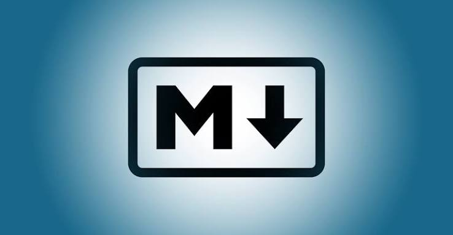

<!--Mon projet est une plateforme de cours. -->
<!-- Elle aide les débutants à apprendre le code -->
<!-- Je vais présenter mon projet. -->
# Présentation de mon projet technique

## Plateforme De Cours


# 1. Sujet du projet

Mon projet technique est une **Plateforme De Cours**.

C'est une plateforme qui permet aux utilisateurs d'apprendre la programmation et de pratiquer le code.

---

<!-- Mon objectif est de faciliter l'apprentissage. -->
<!-- Les utilisateurs apprennent étape par étape. -->
<!-- Ils peuvent aussi pratiquer le code. -->

# 2. Objectif du projet

L'objectif de mon projet est de faciliter l'apprentissage de la programmation.

La plateforme permet de :

- Apprendre les bases du code.
- Comprendre les langages de programmation.
- Faire des exercices pratiques.
- Améliorer ses compétences.
- Apprendre étape par étape.

> Apprendre à coder simplement et facilement.

---
<!-- utilisateur peut créer un compte et se connecter.-->
<!-- Il peut consulter les cours et faire des exercices.-->
<!-- Il peut écrire du code et voir les résultats. -->
# 3. Les fonctionnalités de la plateforme

La plateforme propose plusieurs fonctionnalités :

1. Créer un compte.
2. Se connecter.
3. Consulter les cours.
4. Faire des exercices.
5. Écrire du code.
6. Voir les résultats.

---
<!--J'ai défini le sujet et les objectifs.-->
<!-- J'ai créé l'interface de la plateforme. -->
<!--Je dois développer et tester les fonctionnalités.  -->
# 4. Les tâches du projet

Voici les tâches à réaliser :

- [x] Définir le sujet du projet.
- [x] Définir les objectifs.
- [x] Créer l'interface.
- [ ] Développer les fonctionnalités.
- [ ] Tester la plateforme.
- [ ] Corriger les erreurs.

---
<!--HTML crée la structure des pages.-->
<!--CSS et JavaScript rendent le site interactif.-->
<!--PHP et SQL gèrent les données. -->
# 5. Les langages de programmation

Pour réaliser ce projet, nous pouvons utiliser plusieurs langages :

| Langage    | Utilisation          |
| ---------- | -------------------- |
| HTML       | Structure de la page |
| CSS        | Design de la page    |
| JavaScript | Interactivité        |
| PHP        | Partie serveur       |
| SQL        | Gestion des données  |
---
<!--Voici un exemple simple en HTML.-->
<!-- Ce code affiche un titre et un texte. -->
<!-- Il présente ma plateforme aux utilisateurs.  -->
# 6. Exemple de code

Voici un petit exemple en HTML :

```html
<!DOCTYPE html>
<html>
<head>
    <title>Ma plateforme</title>
</head>
<body>
    <h1>Bienvenue sur ma plateforme</h1>
    <p>Apprendre à coder facilement.</p>
</body>
</html>

```

---
<!--J'utilise W3Schools pour apprendre.-->
<!-- Je consulte MDN pour comprendre le code. -->
<!--J'utilise PHP Documentation pour apprendre PHP.  -->
# 7. Ressources utiles

Pour apprendre et développer la plateforme :

- [W3Schools](https://www.w3schools.com/)
- [MDN Web Docs](https://developer.mozilla.org/)
- [PHP Documentation](https://www.php.net/docs.php)
- 
---
<!-- Mon projet aide les débutants à apprendre.  -->
<!-- Il rend la programmation plus facile.  -->
<!-- Merci pour votre attention !   -->
# 8. Conclusion

Pour conclure, mon projet est une **Plateforme De Cours** destinée aux débutants de niveau A1.

Son objectif est de rendre l'apprentissage de la programmation simple, pratique et accessible.

**Merci pour votre attention !**

---
<!-- Apprendre aujourd'hui, c'est coder demain.-->
<!-- Chaque difficulté est une occasion d'apprendre. -->
<!-- Avec la pratique, je peux progresser. -->
# Fin de la présentation

*Apprendre aujourd'hui, coder demain !*

~~Les difficultés ne sont pas des obstacles.~~

**Elles sont des occasions d'apprendre.**
