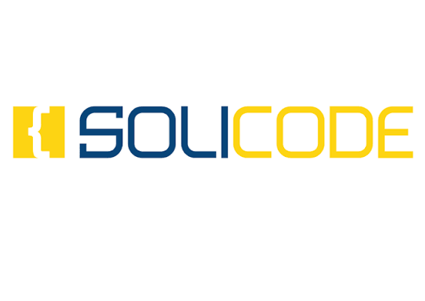

<!-- _class: title -->
<!-- _paginate: false -->

# Labs et technologies

## Projet technique

**Plateforme de cours**

**Réalisé par :** Aziza ELhamyani

**Encadrant :** ES-Saraj Fouad

**Centre de formation :** Solicode Tanger

**Institution :** OFPPT

---

<!-- _class: intro -->

# Projet technique

## Introduction

Un projet technique permet de pratiquer ce que nous apprenons en formation.

Nous utilisons différentes technologies et différents outils pour créer une application web.

## Plateforme de cours

Notre projet est une plateforme web de cours en ligne.

Elle permet aux utilisateurs de consulter des cours et d'apprendre de nouvelles choses.

L'administrateur peut gérer :
- Les cours.
- Les catégories.
- Les contenus des cours.
- Les utilisateurs.
La plateforme permet de trouver les cours facilement et de bien organiser les informations..

---

<!-- _class: stack -->

# Les technologies utilisées

Notre projet utilise plusieurs technologies.

Chaque technologie a un rôle.

## Structure et design

- **HTML** — Crée la structure des pages.
- **CSS** — Ajoute le style.
- **Tailwind CSS** — Aide à créer le design.

## Langages de programmation

- **JavaScript** — Ajoute des actions dans les pages.
- **PHP** — Gère les informations côté serveur.

## Frameworks et bibliothèques

- **Laravel** — Framework PHP.
- **Alpine.js** — Ajoute des interactions dans les pages.

## Base de données et ORM

- **MySQL** — Stocke les informations.
- **Eloquent ORM** — Aide à utiliser la base de données avec Laravel.

---

# Comprendre les Labs

## Qu'est-ce qu'un Lab ?

Un Lab est un exercice pratique.

Il permet de découvrir une technologie ou un outil.

## Pourquoi faire des Labs ?

- Découvrir de nouvelles technologies.
- Tester des outils.
- Pratiquer le code.
- Apprendre à résoudre des problèmes.

## Le lien avec le projet technique

Les Labs nous aident à préparer notre projet.

Nous testons les technologies avant de les utiliser dans le projet final.

> Un Lab permet de passer de la théorie à la pratique.

---

<!-- _class: labs -->

# Liste des Labs

## Phase 1 — Outils et technologies (1–10)

<ol>
<li>Qu'est-ce qu'un Lab ? — Découvrir les Labs</li>
<li>Markdown — Écrire des documents</li>
<li>GitHub Pages — Publier un site web</li>
<li>Antigravity — Gérer un projet Python</li>
<li>Marp — Créer des présentations</li>
<li>OpenCode — Environnement de développement</li>
<li>Pandoc — Convertir des documents</li>
<li>OmniRoute — Gérer le routage</li>
<li>Tailwind CSS — Créer le design</li>
<li>Preline — Utiliser des composants web</li>
</ol>

## Phase 2 — Méthodes et travail en équipe (11–15)

<ol start="11">
<li>2TUP — Méthode de développement</li>
<li>Design Thinking — Comprendre les besoins</li>
<li>GitHub Issues — Gérer les tâches</li>
<li>Scrum — Méthode de travail en équipe</li>
<li>GitHub Copilot — Aide à la programmation</li>
</ol>

## Phase 3 — Développement et langages (16–24)

<ol start="16">
<li>POO — Programmation orientée objet</li>
<li>PHP Native — PHP sans framework</li>
<li>Laravel — Framework PHP</li>
<li>Kotlin — Langage de programmation</li>
<li>ES7 JavaScript — JavaScript moderne</li>
<li>Erreurs JS — Comprendre les erreurs JavaScript</li>
<li>Prompt-Agent-Skill — Utiliser l'IA</li>
<li>Communication avec IA — Parler avec l'IA</li>
</ol>

## Phase 4 — Projet et production (25–30)

<ol start="25">
<li>Veille technologique — Suivre les nouveautés</li>
<li>Starter — Utiliser un modèle de projet</li>
<li>Planning — Organiser le travail</li>
<li>Git — Gérer les versions du code</li>
<li>Lab Stack — Découvrir les technologies</li>
<li>Agent — Automatiser des tâches avec l'IA</li>
</ol>

---

<!-- _class: thanks -->
<!-- _paginate: false -->

# Merci pour votre attention !

## Avez-vous des questions ?

**Labs et technologies**

Aziza ELhamyani — Solicode Tanger